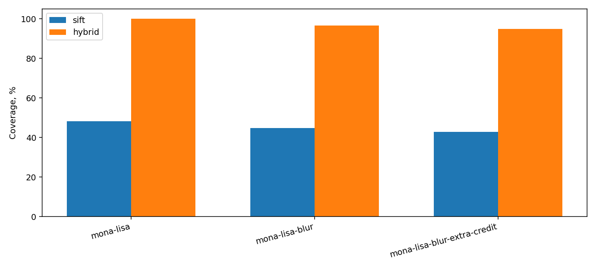
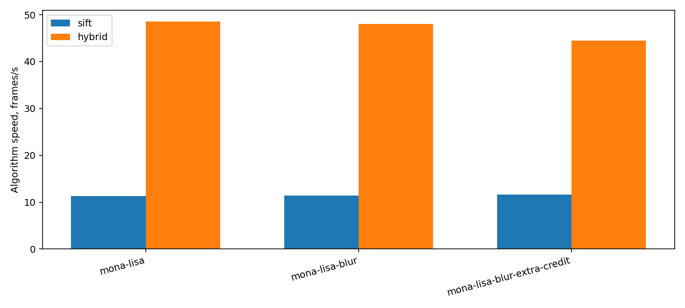

# ЛР2 — трекинг плоского объекта

| Видео | Метод | Кадры с рамкой (без первого) | Покрытие | FPS | Инлаеры, среднее | Ошибка репроекции, px |
|---|---|---:|---:|---:|---:|---:|
| mona-lisa | sift | 269/557 | 48.29% | 11.34 | 82.3 | 0.85 |
| mona-lisa | hybrid | 557/557 | 100.00% | 48.52 | 106.1 | 0.63 |
| mona-lisa-blur | sift | 250/557 | 44.88% | 11.46 | 66.2 | 0.84 |
| mona-lisa-blur | hybrid | 538/557 | 96.59% | 48.03 | 101.7 | 0.64 |
| mona-lisa-blur-extra-credit | sift | 239/557 | 42.91% | 11.60 | 67.1 | 0.86 |
| mona-lisa-blur-extra-credit | hybrid | 529/557 | 94.97% | 44.51 | 103.1 | 0.62 |

Покрытие — доля кадров с принятой рамкой, не точность локализации. FPS учитывает вычисления трекера, без записи и декодирования видео. Без покадровой разметки нельзя измерить точность границ или долю ложных срабатываний.

## Графики

Дополнительные ролики в данном запуске отсутствуют.

