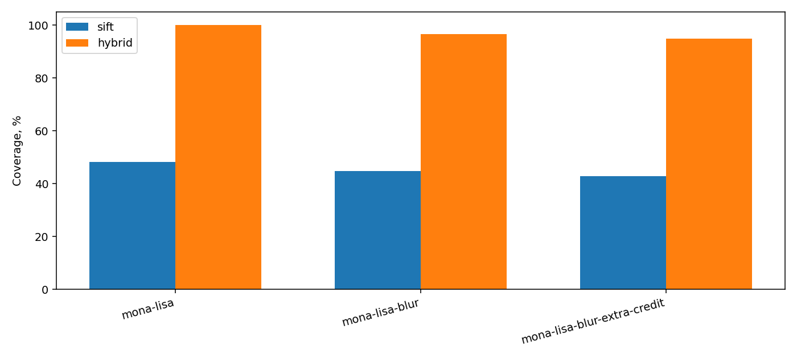
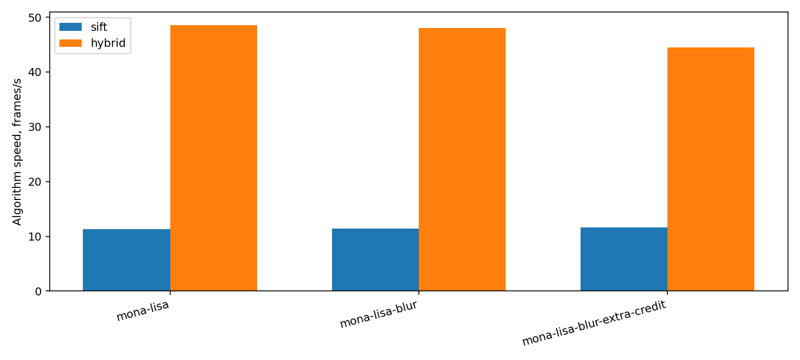

# Лабораторная работа №2. Трекинг объекта по ключевым точкам

Цель работы — реализовать алгоритм отслеживания плоского объекта на видео с построением перспективной рамки и подписи.

## 1. Теоретическая база

### SIFT и сопоставление признаков

SIFTвыделяет характерные точки в масштабном пространстве изображения $L(x,y,\sigma)=G_\sigma*I$. Экстремумы разности гауссианов

$$D(x,y,\sigma)=L(x,y,k\sigma)-L(x,y,\sigma)$$

используются для построения 128-мерных дескрипторов, устойчивых к изменению масштаба и повороту. Соответствия между кадрами ищутся по евклидову расстоянию. Для отбрасывания неоднозначных совпадений применяется тест Лоу: $d_1<0.75d_2$.

### Гомография и RANSAC

Изображения плоского объекта связаны проективным преобразованием:

$$\lambda\begin{pmatrix}u\\v\\1\end{pmatrix}=H_t\begin{pmatrix}x\\y\\1\end{pmatrix},\qquad H_t\in\mathbb R^{3\times3}.$$

Для оценки гомографии требуется не менее четырёх соответствий в общей позиции. RANSAC [2] отбрасывает выбросы, выбирая модель с достаточным количеством инлаеров:

$$\mathcal I(H)=\{i:\|p_i'-\pi(H\bar p_i)\|_2\leq\tau\},$$

где $\pi$ — переход к неоднородным координатам. Преобразование четырёх углов эталона позволяет построить рамку с учётом перспективы.

### Оптический поток Lucas–Kanade

При предположении о сохранении яркости между соседними кадрами получаем $I_xu+I_yv+I_t\approx0$. Смещение точки определяется решением задачи:

$$\min_{u,v}\sum_{p\in\Omega}(I_x(p)u+I_y(p)v+I_t(p))^2.$$

Пирамидальная схема позволяет учитывать большие смещения, а проверка прямого и обратного потока отбрасывает нестабильные соответствия. Для добавления точек применяется критерий Shi–Tomasi.

## 2. Описание разработанной системы

Реализованы два режима:

- `sift` — независимый поиск объекта по первому кадру с помощью SIFT и RANSAC на каждом кадре.
- `hybrid` — сопровождение точек оптическим потоком и повторный поиск по SIFT каждые 10 кадров либо при потере или недостаточной поддержке трекинга.

Эталоном по умолчанию служит весь первый кадр. При наличии фона можно задать четыре угла вручную. Для уменьшения дрейфа сравниваются оценки гомографии по потоку и SIFT, проверяются выпуклость, площадь рамки и распределение инлаеров. При отсутствии допустимой модели рамка не рисуется.

Реализация использует Python, OpenCV, NumPy и Matplotlib. `tracker.py` содержит алгоритмы трекинга, `main.py` — обработку видео, `select.py` — выбор углов, `experiment.py` и `report.py` — эксперименты и отчётность, `tests/` — тесты.

## 3. Результаты работы и тестирования

Источник: [GitHub Actions, запуск 45669350627](https://github.com/dddashhh/CV_labs/actions/runs/45669350627), артефакт `lab2-results-45669350627-1`, файлы `metrics.csv` и `tests.xml`.

Обработаны три учебных видео по 558 кадров: исходное, с размытием и с усиленным размытием. Первый кадр используется как эталон и исключается из покрытия.

Покрытие $C=N_{found}/(T-1)$ — доля кадров с принятой рамкой; FPS — скорость вычислений трекера без декодирования, отрисовки и записи. Ошибка репроекции измеряется по инлаерам, а не по истинным углам объекта.

| Видео | Метод | Кадры с рамкой | Покрытие | FPS | Инлаеры | Ошибка, px |
|---|---|---:|---:|---:|---:|---:|
| Mona Lisa | SIFT | 269/557 | 48.29% | 11.34 | 82.3 | 0.85 |
| Mona Lisa | Hybrid | 557/557 | 100.00% | 48.52 | 106.1 | 0.63 |
| Mona Lisa Blur | SIFT | 250/557 | 44.88% | 11.46 | 66.2 | 0.84 |
| Mona Lisa Blur | Hybrid | 538/557 | 96.59% | 48.03 | 101.7 | 0.64 |
| Extra Credit | SIFT | 239/557 | 42.91% | 11.60 | 67.1 | 0.86 |
| Extra Credit | Hybrid | 529/557 | 94.97% | 44.51 | 103.1 | 0.62 |

Гибридный алгоритм повысил суммарное покрытие с 45.36% (758/1671) до 97.19% (1624/1671). Средняя по роликам скорость выросла с 11.47 до 47.02 FPS, примерно в 4.1 раза. Это согласуется с использованием более дешёвого оптического потока вместо SIFT на каждом кадре. При усилении размытия покрытие обоих методов снижается, однако гибридный сохраняет более 94%.

Покрытие не равно точности локализации: без покадровой разметки нельзя определить IoU с эталоном и долю ложных рамок. Ошибка репроекции характеризует внутреннюю согласованность найденных точек.

В данном запуске успешно пройдены все 9 тестов. Проверены гомография при выбросах, геометрия рамки, восстановление трекинга, отрисовка и обработка реального видео. GitHub Actions сохраняет метрики, графики, отчёт и обработанные MP4 в Artifacts.

Собственные и дополнительные видео (`test-my-own.MOV`, `bad-test.MOV`, `simple_track.avi`) в предоставленном артефакте отсутствуют. Их результаты ещё не подтверждены; для выполнения пункта задания о собственной съёмке требуется отдельный прогон с этими файлами.

