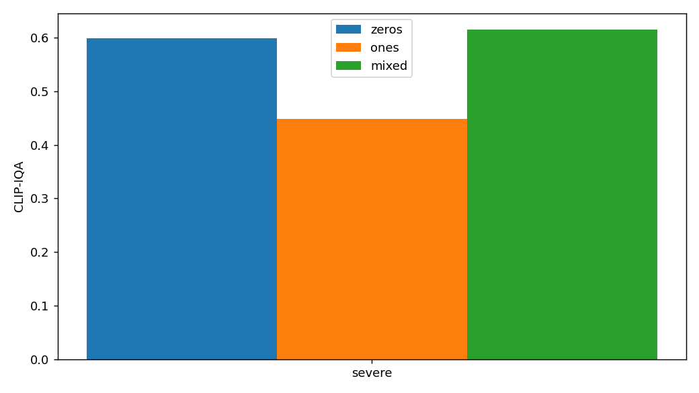
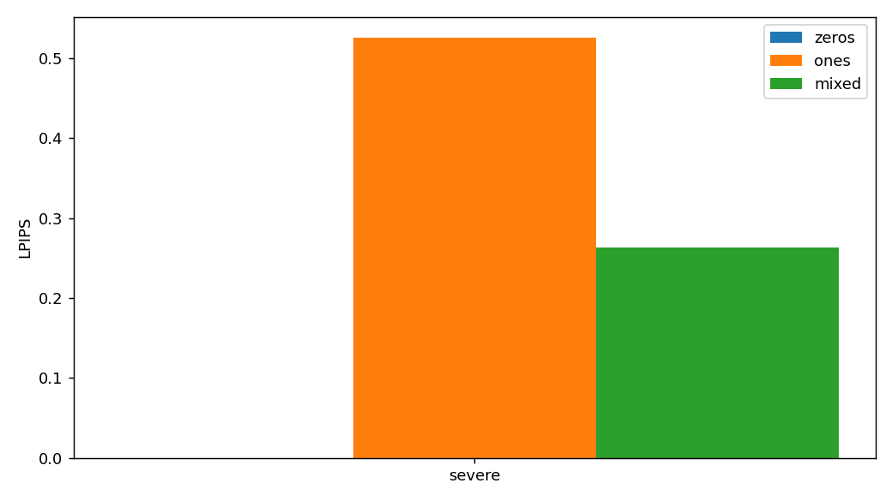
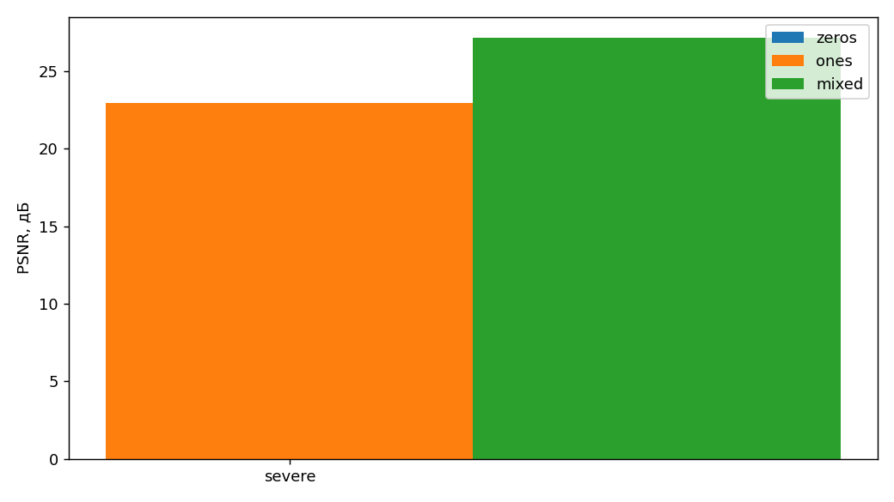
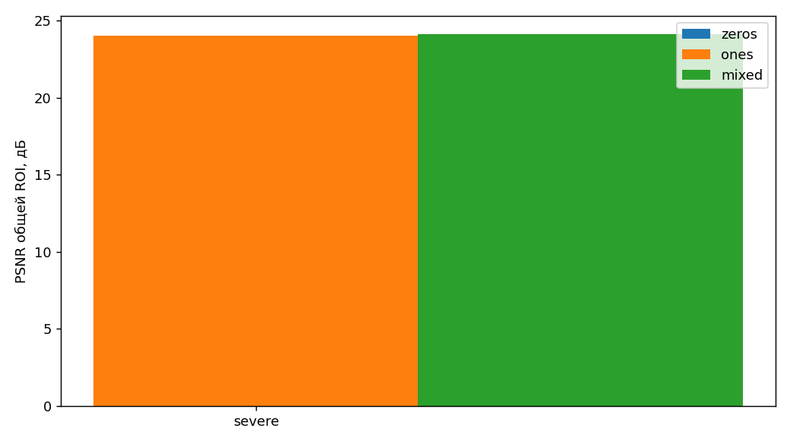
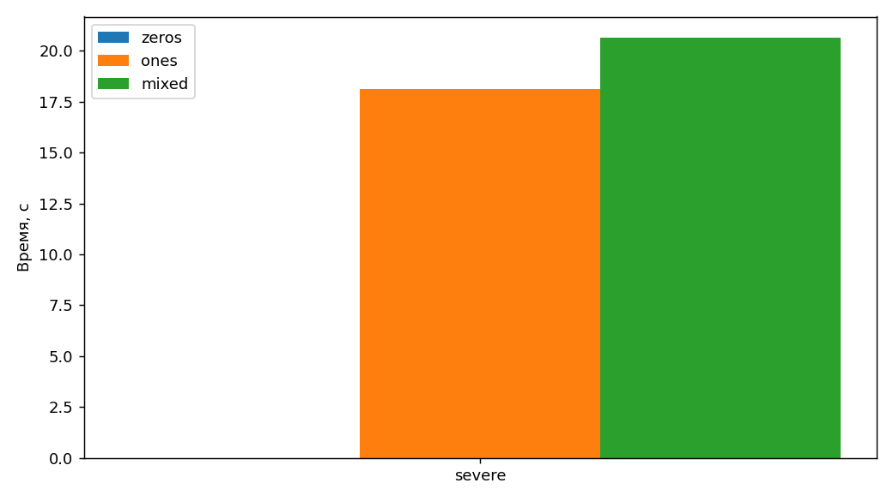

## ЛР3 — SR-inpainting

Выполнено конфигураций: **3**.

Маски: zeros — эталон HR; ones — восстановление по LR; mixed — восстановление с HR-контекстом.

### Средние метрики

| Деградация | Маска | N | PSNR, дБ | LPIPS | CLIP-IQA | PSNR ROI, дБ | Ошибка вне маски | Время, с |
| --- | --- | --- | --- | --- | --- | --- | --- | --- |
| severe | zeros | 1 | ∞ | 0.000 | 0.599 | ∞ | 0 | 0.002 |
| severe | ones | 1 | 22.952 | 0.526 | 0.449 | 24.062 | — | 18.114 |
| severe | mixed | 1 | 27.152 | 0.264 | 0.615 | 24.125 | 0 | 20.650 |

∞ означает точное совпадение с HR; — означает неприменимую или отсутствующую метрику.

### Сравнение на одинаковой ROI

| Изображение | Деградация | Ones, дБ | Mixed, дБ | Δ PSNR ROI, дБ |
| --- | --- | --- | --- | --- |
| 0801 | severe | 24.062 | 24.125 | 0.063 |

Положительный Δ PSNR ROI означает преимущество HR-контекста по PSNR на восстанавливаемой области.

Сравнительные панели, отдельные изображения и графики доступны в Artifacts.

### Графики

