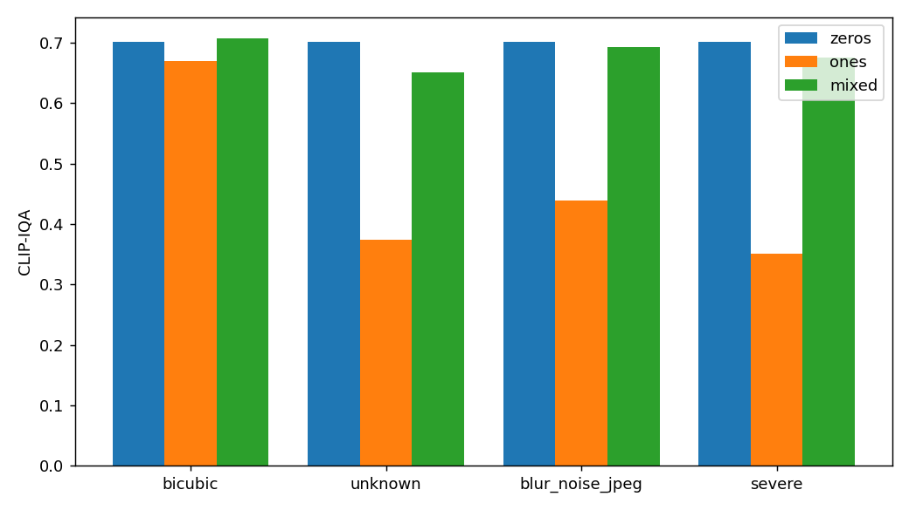
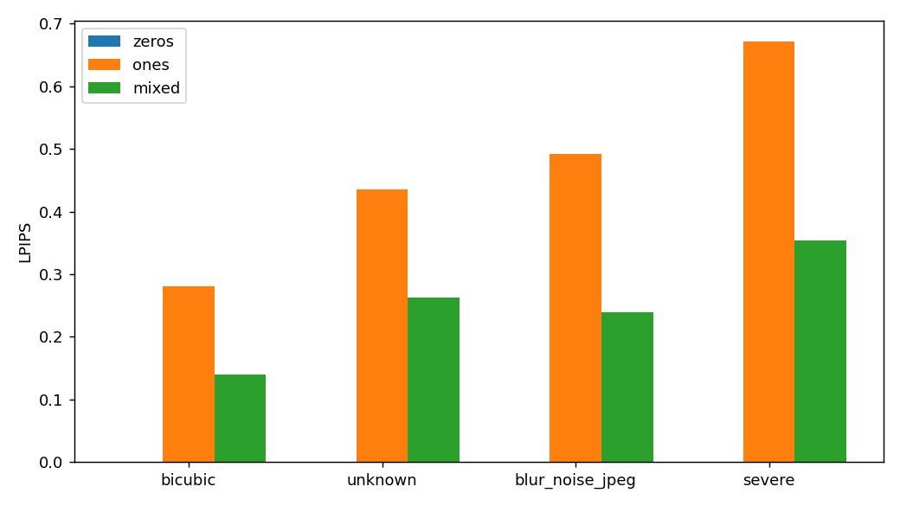
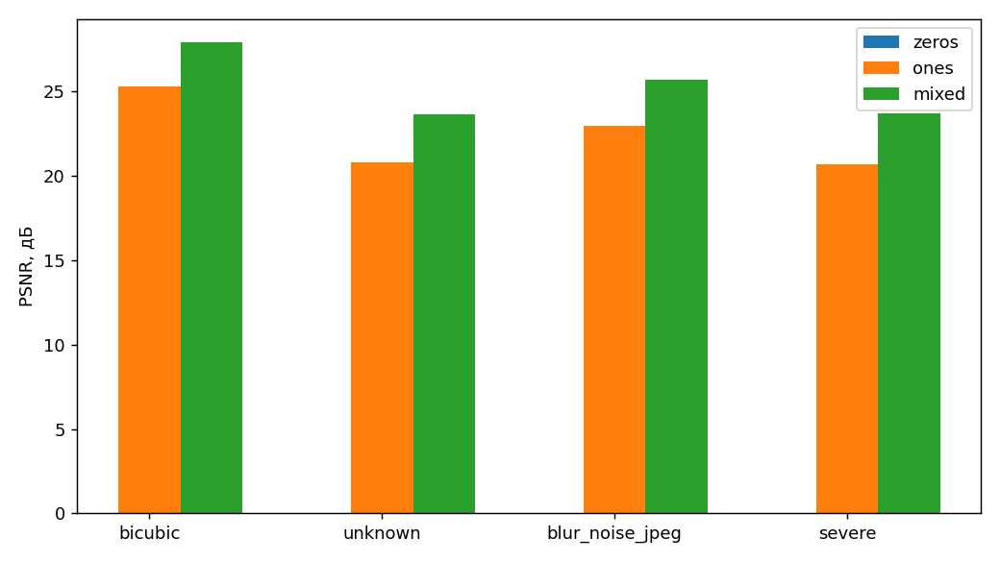
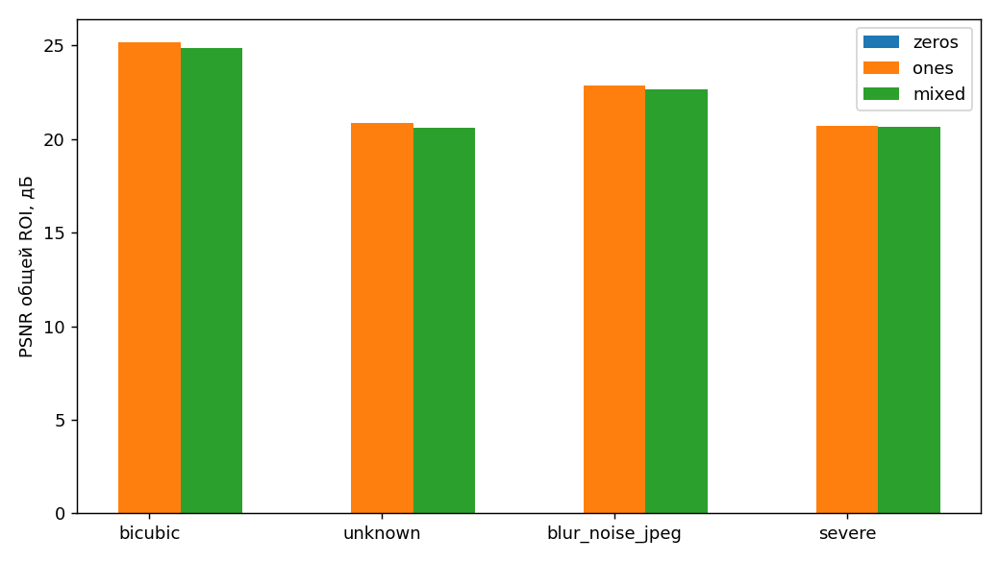
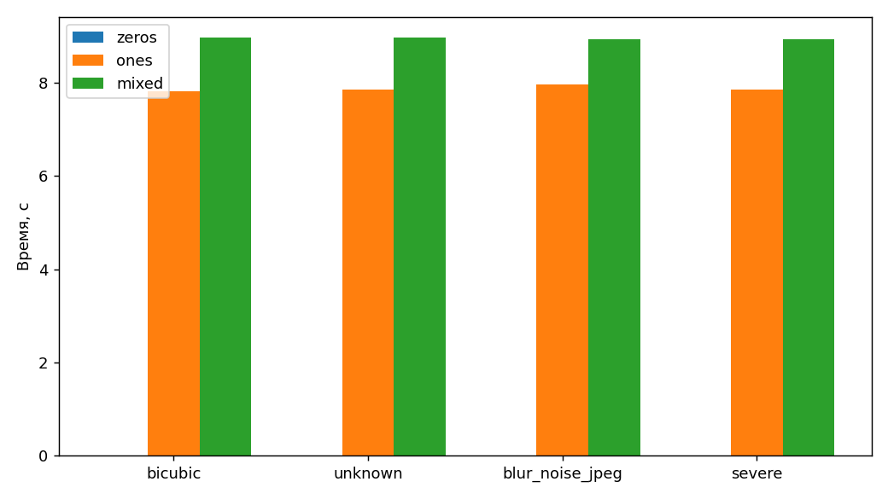

## ЛР3 — SR-inpainting

Выполнено конфигураций: **60**.

Маски: zeros — эталон HR; ones — восстановление по LR; mixed — восстановление с HR-контекстом.

### Средние метрики

| Деградация | Маска | N | PSNR, дБ | LPIPS | CLIP-IQA | PSNR ROI, дБ | Ошибка вне маски | Время, с |
| --- | --- | --- | --- | --- | --- | --- | --- | --- |
| bicubic | zeros | 5 | ∞ | 0.000 | 0.701 | ∞ | 0 | 0.001 |
| bicubic | ones | 5 | 25.261 | 0.280 | 0.669 | 25.166 | — | 7.816 |
| bicubic | mixed | 5 | 27.902 | 0.140 | 0.707 | 24.875 | 0 | 8.971 |
| unknown | zeros | 5 | ∞ | 0.000 | 0.701 | ∞ | 0 | 0.001 |
| unknown | ones | 5 | 20.816 | 0.435 | 0.373 | 20.844 | — | 7.856 |
| unknown | mixed | 5 | 23.642 | 0.262 | 0.651 | 20.614 | 0 | 8.965 |
| blur_noise_jpeg | zeros | 5 | ∞ | 0.000 | 0.701 | ∞ | 0 | 0.001 |
| blur_noise_jpeg | ones | 5 | 22.974 | 0.491 | 0.439 | 22.869 | — | 7.960 |
| blur_noise_jpeg | mixed | 5 | 25.680 | 0.240 | 0.693 | 22.652 | 0 | 8.936 |
| severe | zeros | 5 | ∞ | 0.000 | 0.701 | ∞ | 0 | 0.001 |
| severe | ones | 5 | 20.653 | 0.671 | 0.351 | 20.721 | — | 7.848 |
| severe | mixed | 5 | 23.670 | 0.354 | 0.675 | 20.643 | 0 | 8.934 |

∞ означает точное совпадение с HR; — означает неприменимую или отсутствующую метрику.

### Сравнение на одинаковой ROI

| Изображение | Деградация | Ones, дБ | Mixed, дБ | Δ PSNR ROI, дБ |
| --- | --- | --- | --- | --- |
| 0801 | bicubic | 30.865 | 30.976 | 0.111 |
| 0801 | unknown | 22.407 | 22.400 | -0.007 |
| 0801 | blur_noise_jpeg | 27.468 | 27.562 | 0.094 |
| 0801 | severe | 24.062 | 24.125 | 0.063 |
| 0804 | bicubic | 24.552 | 24.662 | 0.110 |
| 0804 | unknown | 19.713 | 19.671 | -0.041 |
| 0804 | blur_noise_jpeg | 21.300 | 21.265 | -0.035 |
| 0804 | severe | 19.016 | 18.941 | -0.076 |
| 0810 | bicubic | 19.617 | 19.354 | -0.263 |
| 0810 | unknown | 17.471 | 16.785 | -0.686 |
| 0810 | blur_noise_jpeg | 18.261 | 17.884 | -0.377 |
| 0810 | severe | 17.450 | 17.373 | -0.076 |
| 0829 | bicubic | 20.072 | 19.614 | -0.457 |
| 0829 | unknown | 17.823 | 17.549 | -0.273 |
| 0829 | blur_noise_jpeg | 18.751 | 18.489 | -0.262 |
| 0829 | severe | 17.350 | 17.325 | -0.025 |
| 0855 | bicubic | 30.724 | 29.767 | -0.957 |
| 0855 | unknown | 26.805 | 26.666 | -0.139 |
| 0855 | blur_noise_jpeg | 28.564 | 28.061 | -0.503 |
| 0855 | severe | 25.725 | 25.448 | -0.277 |

Положительный Δ PSNR ROI означает преимущество HR-контекста по PSNR на восстанавливаемой области.

Сравнительные панели, отдельные изображения и графики доступны в Artifacts.

### Графики

