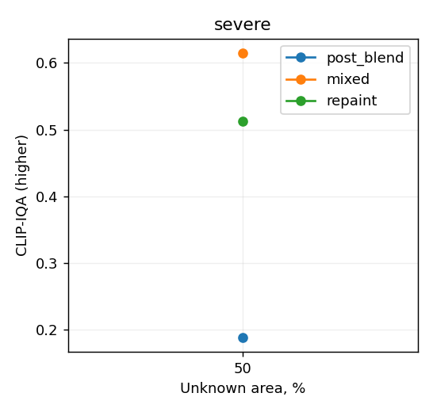
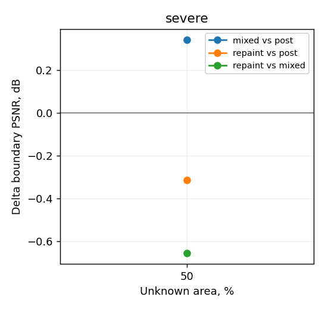
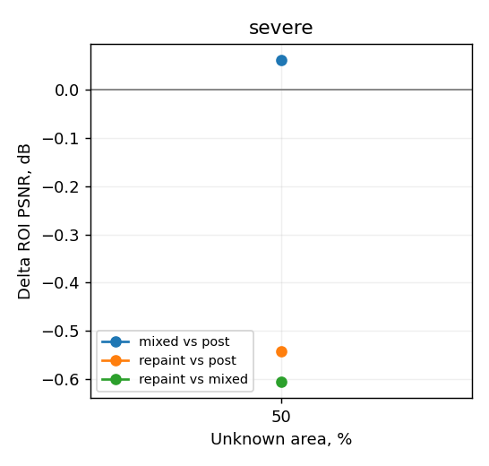
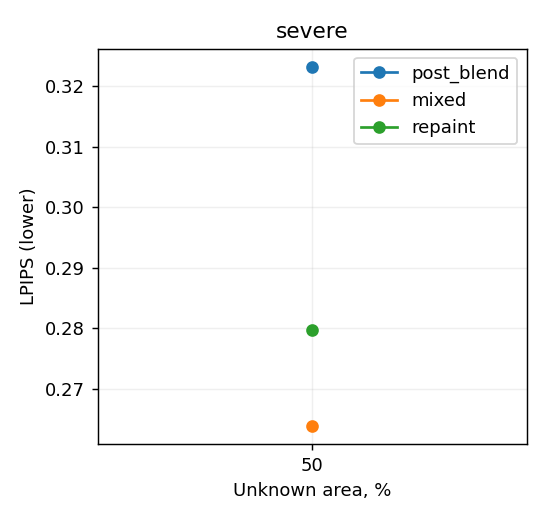
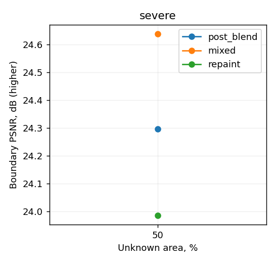
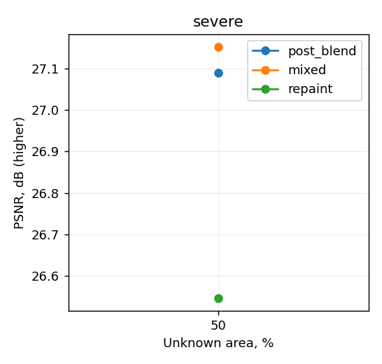
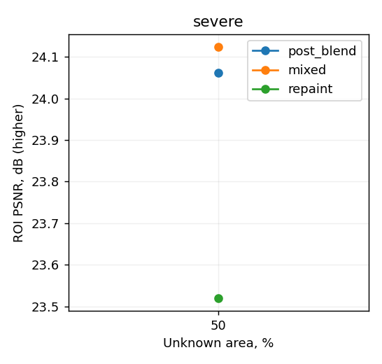
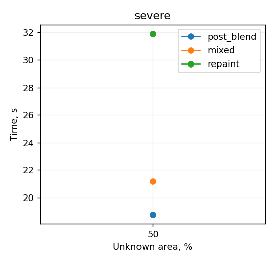

## ЛР3 — расширенный эксперимент

Выполнено конфигураций: **5**.

Post-blend использует тот же результат Ones и известный HR только при финальной склейке. Mixed использует HR на каждом обратном шаге; RePaint добавляет повторное зашумление. Сравнение проводится при одинаковой маске, LR, HR и seed. Для PSNR и CLIP-IQA положительная разность лучше, для LPIPS и времени — отрицательная. PSNR ROI сравним между методами при одной площади. Нулевой режим — контроль, а не конкурент.

### Парные сравнения

| Деградация | Маска, % | N | Mixed − Post, ROI дБ | RePaint − Post, ROI дБ | RePaint − Mixed, ROI дБ | RePaint > Mixed | RePaint − Mixed, граница дБ | RePaint − Mixed, LPIPS | RePaint − Mixed, CLIP-IQA | RePaint − Mixed, с |
| --- | --- | --- | --- | --- | --- | --- | --- | --- | --- | --- |
| severe | 50 | 1 | 0.063 | -0.543 | -0.606 | 0 | -0.655 | 0.016 | -0.102 | 10.762 |

### Средние метрики

| Деградация | Маска | N | PSNR, дБ | LPIPS | CLIP-IQA | PSNR ROI, дБ | Ошибка вне маски | Время, с | PSNR границы, дБ | Доля маски |
| --- | --- | --- | --- | --- | --- | --- | --- | --- | --- | --- |
| severe | zeros | 1 | ∞ | 0.000 | 0.599 | — | 0 | 0.000 | — | 0.000 |
| severe | ones | 1 | 22.952 | 0.526 | 0.449 | — | — | 18.747 | — | 1.000 |
| severe | post_blend_50 | 1 | 27.090 | 0.323 | 0.188 | 24.062 | 0 | 18.748 | 24.297 | 0.498 |
| severe | mixed_50 | 1 | 27.152 | 0.264 | 0.615 | 24.125 | 0 | 21.161 | 24.639 | 0.498 |
| severe | repaint_50 | 1 | 26.546 | 0.280 | 0.513 | 23.519 | 0 | 31.923 | 23.984 | 0.498 |

Полные попарные результаты, изображения и графики доступны в Artifacts.

### Графики

