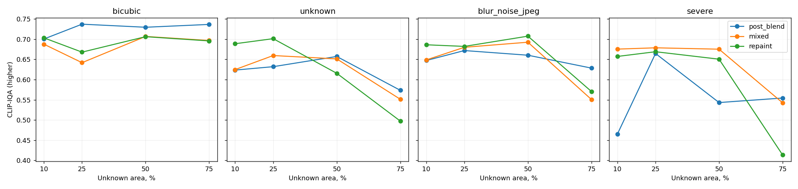
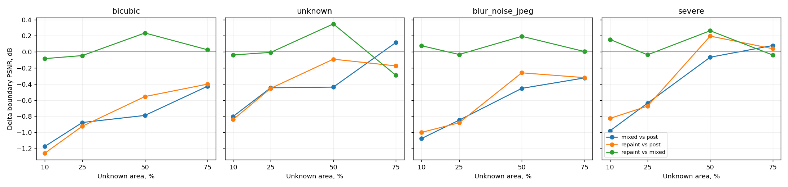
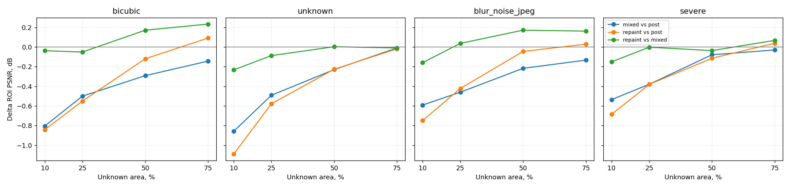
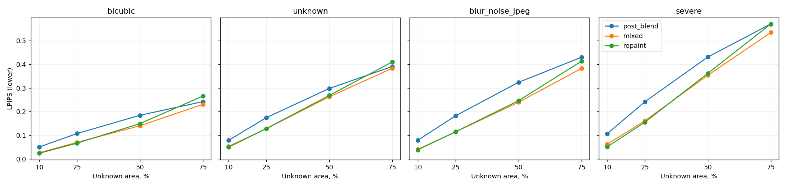
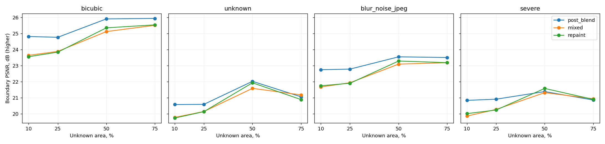
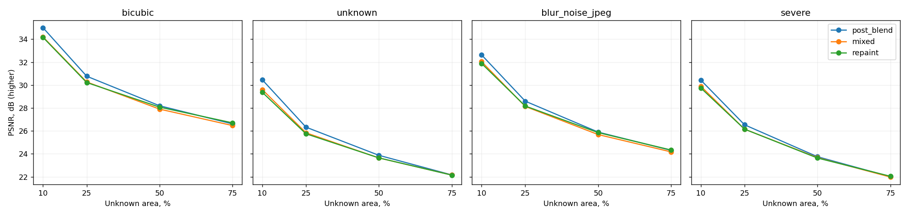
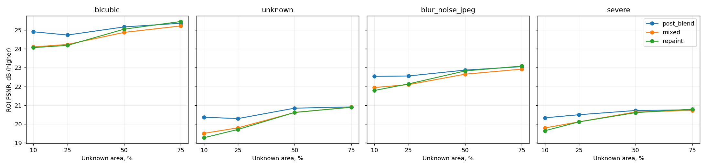
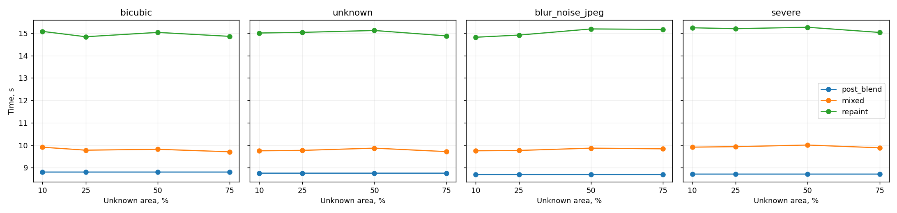

## ЛР3 — расширенный эксперимент

Выполнено конфигураций: **280**.

Post-blend использует тот же результат Ones и известный HR только при финальной склейке. Mixed использует HR на каждом обратном шаге; RePaint добавляет повторное зашумление. Сравнение проводится при одинаковой маске, LR, HR и seed. Для PSNR и CLIP-IQA положительная разность лучше, для LPIPS и времени — отрицательная. PSNR ROI сравним между методами при одной площади. Нулевой режим — контроль, а не конкурент.

### Парные сравнения

| Деградация | Маска, % | N | Mixed − Post, ROI дБ | RePaint − Post, ROI дБ | RePaint − Mixed, ROI дБ | RePaint > Mixed | RePaint − Mixed, граница дБ | RePaint − Mixed, LPIPS | RePaint − Mixed, CLIP-IQA | RePaint − Mixed, с |
| --- | --- | --- | --- | --- | --- | --- | --- | --- | --- | --- |
| bicubic | 10 | 5 | -0.805 | -0.842 | -0.037 | 2 | -0.084 | -0.002 | 0.016 | 5.168 |
| bicubic | 25 | 5 | -0.500 | -0.551 | -0.050 | 3 | -0.046 | -0.003 | 0.026 | 5.062 |
| bicubic | 50 | 5 | -0.291 | -0.119 | 0.172 | 5 | 0.234 | 0.009 | -0.001 | 5.215 |
| bicubic | 75 | 5 | -0.143 | 0.092 | 0.235 | 5 | 0.026 | 0.035 | -0.001 | 5.151 |
| unknown | 10 | 5 | -0.859 | -1.091 | -0.233 | 2 | -0.038 | -0.003 | 0.064 | 5.256 |
| unknown | 25 | 5 | -0.491 | -0.578 | -0.087 | 2 | -0.007 | 0.000 | 0.042 | 5.267 |
| unknown | 50 | 5 | -0.229 | -0.226 | 0.004 | 3 | 0.347 | 0.006 | -0.036 | 5.251 |
| unknown | 75 | 5 | -0.009 | -0.018 | -0.009 | 2 | -0.291 | 0.026 | -0.054 | 5.165 |
| blur_noise_jpeg | 10 | 5 | -0.591 | -0.749 | -0.158 | 2 | 0.076 | -0.002 | 0.038 | 5.066 |
| blur_noise_jpeg | 25 | 5 | -0.460 | -0.423 | 0.038 | 4 | -0.033 | 0.001 | 0.002 | 5.148 |
| blur_noise_jpeg | 50 | 5 | -0.217 | -0.044 | 0.172 | 4 | 0.193 | 0.007 | 0.015 | 5.321 |
| blur_noise_jpeg | 75 | 5 | -0.133 | 0.029 | 0.163 | 5 | 0.004 | 0.031 | 0.020 | 5.328 |
| severe | 10 | 5 | -0.536 | -0.687 | -0.151 | 2 | 0.154 | -0.011 | -0.018 | 5.327 |
| severe | 25 | 5 | -0.379 | -0.381 | -0.001 | 2 | -0.037 | -0.006 | -0.010 | 5.265 |
| severe | 50 | 5 | -0.078 | -0.114 | -0.036 | 4 | 0.262 | 0.008 | -0.025 | 5.257 |
| severe | 75 | 5 | -0.029 | 0.039 | 0.068 | 3 | -0.040 | 0.036 | -0.129 | 5.148 |

### Средние метрики

| Деградация | Маска | N | PSNR, дБ | LPIPS | CLIP-IQA | PSNR ROI, дБ | Ошибка вне маски | Время, с | PSNR границы, дБ | Доля маски |
| --- | --- | --- | --- | --- | --- | --- | --- | --- | --- | --- |
| bicubic | zeros | 5 | ∞ | 0.000 | 0.701 | — | 0 | 0.000 | — | 0.000 |
| bicubic | ones | 5 | 25.261 | 0.280 | 0.669 | — | — | 8.802 | — | 1.000 |
| bicubic | post_blend_10 | 5 | 35.010 | 0.050 | 0.701 | 24.907 | 0 | 8.802 | 24.810 | 0.098 |
| bicubic | mixed_10 | 5 | 34.206 | 0.026 | 0.688 | 24.103 | 0 | 9.912 | 23.635 | 0.098 |
| bicubic | repaint_10 | 5 | 34.168 | 0.024 | 0.703 | 24.065 | 0 | 15.080 | 23.550 | 0.098 |
| bicubic | post_blend_25 | 5 | 30.772 | 0.107 | 0.737 | 24.734 | 0 | 8.803 | 24.760 | 0.249 |
| bicubic | mixed_25 | 5 | 30.272 | 0.070 | 0.642 | 24.234 | 0 | 9.779 | 23.883 | 0.249 |
| bicubic | repaint_25 | 5 | 30.221 | 0.067 | 0.668 | 24.183 | 0 | 14.841 | 23.836 | 0.249 |
| bicubic | post_blend_50 | 5 | 28.193 | 0.185 | 0.730 | 25.166 | 0 | 8.802 | 25.906 | 0.498 |
| bicubic | mixed_50 | 5 | 27.902 | 0.140 | 0.707 | 24.875 | 0 | 9.819 | 25.116 | 0.498 |
| bicubic | repaint_50 | 5 | 28.074 | 0.149 | 0.706 | 25.047 | 0 | 15.034 | 25.350 | 0.498 |
| bicubic | post_blend_75 | 5 | 26.612 | 0.242 | 0.737 | 25.362 | 0 | 8.802 | 25.936 | 0.750 |
| bicubic | mixed_75 | 5 | 26.469 | 0.231 | 0.697 | 25.219 | 0 | 9.707 | 25.509 | 0.750 |
| bicubic | repaint_75 | 5 | 26.703 | 0.266 | 0.696 | 25.454 | 0 | 14.858 | 25.535 | 0.750 |
| unknown | zeros | 5 | ∞ | 0.000 | 0.701 | — | 0 | 0.000 | — | 0.000 |
| unknown | ones | 5 | 20.816 | 0.435 | 0.373 | — | — | 8.753 | — | 1.000 |
| unknown | post_blend_10 | 5 | 30.466 | 0.079 | 0.624 | 20.363 | 0 | 8.753 | 20.573 | 0.098 |
| unknown | mixed_10 | 5 | 29.608 | 0.053 | 0.625 | 19.505 | 0 | 9.752 | 19.771 | 0.098 |
| unknown | repaint_10 | 5 | 29.375 | 0.049 | 0.689 | 19.272 | 0 | 15.007 | 19.732 | 0.098 |
| unknown | post_blend_25 | 5 | 26.327 | 0.174 | 0.632 | 20.290 | 0 | 8.753 | 20.585 | 0.249 |
| unknown | mixed_25 | 5 | 25.836 | 0.128 | 0.660 | 19.798 | 0 | 9.770 | 20.139 | 0.249 |
| unknown | repaint_25 | 5 | 25.749 | 0.128 | 0.701 | 19.712 | 0 | 15.037 | 20.132 | 0.249 |
| unknown | post_blend_50 | 5 | 23.871 | 0.298 | 0.657 | 20.844 | 0 | 8.753 | 22.018 | 0.498 |
| unknown | mixed_50 | 5 | 23.642 | 0.262 | 0.651 | 20.614 | 0 | 9.869 | 21.581 | 0.498 |
| unknown | repaint_50 | 5 | 23.645 | 0.268 | 0.616 | 20.618 | 0 | 15.120 | 21.927 | 0.498 |
| unknown | post_blend_75 | 5 | 22.160 | 0.391 | 0.574 | 20.910 | 0 | 8.753 | 21.056 | 0.750 |
| unknown | mixed_75 | 5 | 22.151 | 0.384 | 0.551 | 20.901 | 0 | 9.715 | 21.173 | 0.750 |
| unknown | repaint_75 | 5 | 22.142 | 0.410 | 0.497 | 20.892 | 0 | 14.880 | 20.882 | 0.750 |
| blur_noise_jpeg | zeros | 5 | ∞ | 0.000 | 0.701 | — | 0 | 0.000 | — | 0.000 |
| blur_noise_jpeg | ones | 5 | 22.974 | 0.491 | 0.439 | — | — | 8.689 | — | 1.000 |
| blur_noise_jpeg | post_blend_10 | 5 | 32.639 | 0.079 | 0.647 | 22.536 | 0 | 8.689 | 22.742 | 0.098 |
| blur_noise_jpeg | mixed_10 | 5 | 32.048 | 0.041 | 0.649 | 21.945 | 0 | 9.753 | 21.666 | 0.098 |
| blur_noise_jpeg | repaint_10 | 5 | 31.890 | 0.039 | 0.686 | 21.787 | 0 | 14.819 | 21.742 | 0.098 |
| blur_noise_jpeg | post_blend_25 | 5 | 28.594 | 0.182 | 0.672 | 22.556 | 0 | 8.689 | 22.780 | 0.249 |
| blur_noise_jpeg | mixed_25 | 5 | 28.133 | 0.114 | 0.680 | 22.096 | 0 | 9.767 | 21.932 | 0.249 |
| blur_noise_jpeg | repaint_25 | 5 | 28.171 | 0.115 | 0.682 | 22.133 | 0 | 14.915 | 21.899 | 0.249 |
| blur_noise_jpeg | post_blend_50 | 5 | 25.896 | 0.324 | 0.660 | 22.869 | 0 | 8.689 | 23.544 | 0.498 |
| blur_noise_jpeg | mixed_50 | 5 | 25.680 | 0.240 | 0.693 | 22.652 | 0 | 9.868 | 23.090 | 0.498 |
| blur_noise_jpeg | repaint_50 | 5 | 25.852 | 0.246 | 0.708 | 22.825 | 0 | 15.189 | 23.283 | 0.498 |
| blur_noise_jpeg | post_blend_75 | 5 | 24.303 | 0.430 | 0.629 | 23.054 | 0 | 8.689 | 23.503 | 0.750 |
| blur_noise_jpeg | mixed_75 | 5 | 24.170 | 0.383 | 0.551 | 22.921 | 0 | 9.840 | 23.179 | 0.750 |
| blur_noise_jpeg | repaint_75 | 5 | 24.333 | 0.413 | 0.571 | 23.083 | 0 | 15.168 | 23.183 | 0.750 |
| severe | zeros | 5 | ∞ | 0.000 | 0.701 | — | 0 | 0.000 | — | 0.000 |
| severe | ones | 5 | 20.653 | 0.671 | 0.351 | — | — | 8.711 | — | 1.000 |
| severe | post_blend_10 | 5 | 30.433 | 0.106 | 0.465 | 20.330 | 0 | 8.712 | 20.834 | 0.098 |
| severe | mixed_10 | 5 | 29.897 | 0.062 | 0.676 | 19.795 | 0 | 9.914 | 19.853 | 0.098 |
| severe | repaint_10 | 5 | 29.747 | 0.051 | 0.657 | 19.644 | 0 | 15.242 | 20.008 | 0.098 |
| severe | post_blend_25 | 5 | 26.533 | 0.242 | 0.665 | 20.495 | 0 | 8.712 | 20.906 | 0.249 |
| severe | mixed_25 | 5 | 26.153 | 0.161 | 0.679 | 20.116 | 0 | 9.936 | 20.269 | 0.249 |
| severe | repaint_25 | 5 | 26.152 | 0.155 | 0.669 | 20.115 | 0 | 15.201 | 20.232 | 0.249 |
| severe | post_blend_50 | 5 | 23.748 | 0.431 | 0.543 | 20.721 | 0 | 8.712 | 21.381 | 0.498 |
| severe | mixed_50 | 5 | 23.670 | 0.354 | 0.675 | 20.643 | 0 | 10.008 | 21.315 | 0.498 |
| severe | repaint_50 | 5 | 23.634 | 0.362 | 0.651 | 20.607 | 0 | 15.265 | 21.577 | 0.498 |
| severe | post_blend_75 | 5 | 22.003 | 0.571 | 0.554 | 20.754 | 0 | 8.712 | 20.854 | 0.750 |
| severe | mixed_75 | 5 | 21.974 | 0.535 | 0.543 | 20.725 | 0 | 9.885 | 20.933 | 0.750 |
| severe | repaint_75 | 5 | 22.042 | 0.571 | 0.414 | 20.793 | 0 | 15.033 | 20.893 | 0.750 |

Полные попарные результаты, изображения и графики доступны в Artifacts.

### Графики

