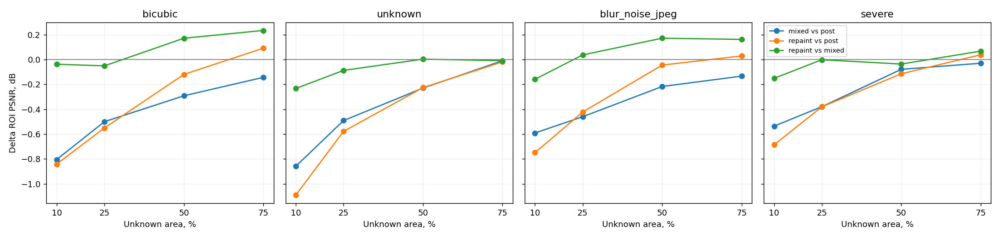
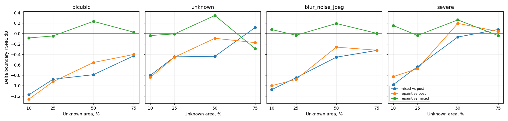
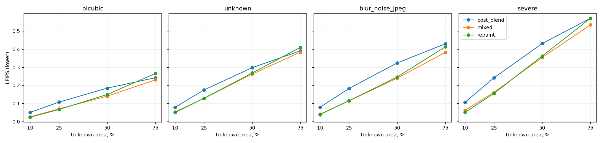
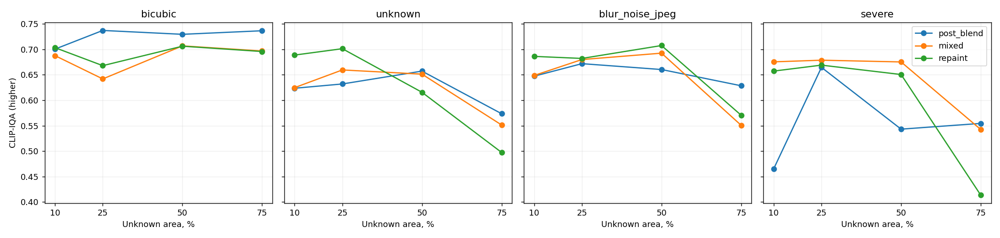

# Лабораторная работа № 3.2

Цель работы — изучить диффузионные image-to-image модели и реализовать сверхразрешение изображения с использованием известных фрагментов HR (SR-inpainting).

## 1. Теоретическая база

Пусть $x$ — LR-изображение размера $64\times64$, $x^*$ — эталонное HR-изображение размера $256\times256$, $M\in\{0,1\}^{64\times64}$ — бинарная маска. Деградация описывается моделью

$$x=\mathcal D(x^*)+n.$$

Маска $M_H$ получается увеличением $M$ методом ближайшего соседа. Единицы обозначают восстанавливаемую область, нули — известные HR-пиксели. Обозначим бикубическое увеличение LR через $b=U_4(x)$. Контекст для энкодера формируется как

$$c=M_H\odot b+(1-M_H)\odot x^*.$$

Так исключается непосредственное использование скрытых HR-пикселей при восстановлении.

### Диффузионная модель ResShift

В отличие от DDPM, где сигнал постепенно превращается в шум, ResShift [1] строит переход между чистым латентом $z_0$ и латентом деградированного изображения $y$ посредством сдвига остатка $y-z_0$. Используется предобученная ResShift v2 (×4, $T=15$, $\kappa=2$) без дообучения.

Пусть $0=\eta_0<\eta_1<\ldots<\eta_T<1$, $a_t=\eta_t-\eta_{t-1}$. Прямой процесс:

$$q(z_t\mid z_{t-1},z_0,y)=\mathcal N(z_{t-1}+a_t(y-z_0),\kappa^2a_tI).$$

Суммирование независимых приращений даёт

$$q(z_t\mid z_0,y)=\mathcal N((1-\eta_t)z_0+\eta_ty,\kappa^2\eta_tI).$$

При $\eta_T\approx1$ начальное состояние обратного процесса приближённо распределено как $\mathcal N(y,\kappa^2\eta_TI)$.

По формуле Байеса обратный переход также является гауссовым. Его параметры:

$$\mu_t=\frac{\eta_{t-1}}{\eta_t}z_t+\frac{a_t}{\eta_t}z_0,\qquad \sigma_t^2=\kappa^2\frac{\eta_{t-1}}{\eta_t}a_t.$$

Поскольку $z_0$ неизвестен, используется его оценка $\hat z_0=f_\theta(z_t,y,t,x_n)$, где $x_n$ — нормализованное LR-условие сети. Обратный шаг:

$$\tilde z_{t-1}=\frac{\eta_{t-1}}{\eta_t}z_t+\frac{a_t}{\eta_t}\hat z_0+\sigma_t\xi_t,\quad \xi_t\sim\mathcal N(0,I).$$

Исходная сеть обучается минимизировать MSE предсказания чистого латента: $\mathcal L=\mathbb E\|f_\theta-z_0\|_2^2$.

## 2. Описание разработанной системы

### Модификация сэмплера

Латентная маска $M_z$ получается max pooling HR-маски по блокам $4\times4$. Известный контекст кодируется как $k_0=E(2c/255-1)$. Для него строится отдельная марковская траектория:

$$k_t=k_{t-1}+a_t(y-k_0)+\kappa\sqrt{a_t}\epsilon_t,\quad \epsilon_t\sim\mathcal N(0,I).$$

На каждом обратном шаге ResShift применяется проектор

$$P_t(z)=M_z\odot z+(1-M_z)\odot k_t,$$

$$z_{t-1}=P_{t-1}(\tilde z_{t-1}).$$

Начальное состояние также проектируется: $z_T=P_T(y+\kappa\sqrt{\eta_T}\xi)$. Известные области присутствуют в латенте перед каждым вызовом U-Net. После декодирования выполняется финальная склейка:

$$\hat x=M_H\odot G(z_0)+(1-M_H)\odot x^*.$$

Она гарантирует точное сохранение HR вне маски. Метод является эвристической условной генерацией: соответствие точному условному распределению не доказано.

### Контрольная склейка и RePaint

Для отделения эффекта диффузионной проекции от подстановки готовых HR-пикселей введён `post_blend`:

$$x_{post}=M_H\odot x_{ones}+(1-M_H)\odot x^*.$$

Здесь $x_{ones}$ — результат обычного ResShift по LR. HR не участвует в генерации.

В режиме `repaint` реализована адаптация идеи RePaint [2] к прямому процессу ResShift. После обратного шага выполняется повторное зашумление с использованием оценки `pred_xstart`:

$$u_t=z_{t-1}+a_t(y-\hat z_0^{(t)})+\kappa\sqrt{a_t}\epsilon,$$

$$z'_t=P_t(u_t).$$

Затем обратный переход повторяется. При $R=2$ число вызовов U-Net составляет $R(T-1)+1=29$ вместо 15. Повторное зашумление на последнем шаге не выполняется. Это адаптация принципа RePaint, а не оригинальный DDPM-алгоритм.

| Режим | Использование HR |
|---|---|
| `zeros` | Возврат полного HR без диффузии |
| `ones` | Восстановление только по LR |
| `post_blend` | Финальная склейка |
| `mixed` | Проекция на каждом обратном шаге |
| `repaint` | Проекция и повторное зашумление |

### Данные и запуск

Использованы пять изображений validation-части DIV2K. Центральные HR/LR-фрагменты согласованы по координатам. Деградации:

| Режим | Описание |
|---|---|
| `bicubic` | Официальная деградация DIV2K ×4 |
| `unknown` | Официальная неизвестная деградация DIV2K ×4 |
| `blur_noise_jpeg` | Gaussian blur 1.7, уменьшение ×4, шум $\sigma=8$, JPEG 45 |
| `severe` | Gaussian blur 5.0, уменьшение ×4, шум $\sigma=25$, JPEG 15 |

Для первой итерации использовались маски 0%, 50% и 100%; для второй добавлены вложенные круговые маски 10%, 25%, 50%, 75%. Фиксированы seed=1234, модель и 15 базовых шагов. Данные автоматически скачиваются с официального сайта и не хранятся в Git.

```bash
python -m pip install torch==2.1.2 torchvision==0.16.2
python -m pip install -r lab3/requirements.txt
python -m lab3.setup_model
python -m pytest lab3/tests -q
python -m lab3.main --study --device cpu
```

Рекомендуемое окружение — Python 3.11. Без `--study` запускается первая итерация. GitHub Actions поддерживает режимы `smoke`, `original`, `full`, автоматически формирует CSV, графики, Markdown- и HTML-отчёты.

## 3. Результаты работы и тестирования

###  Метрики

PSNR измеряет попиксельную точность:

$$\operatorname{PSNR}=10\log_{10}\frac{255^2}{\operatorname{MSE}}.$$

LPIPS оценивает расстояние между нормализованными признаками изображений в AlexNet (меньше — лучше). CLIP-IQA оценивает визуальное качество без эталона по сходству изображения с положительным и отрицательным текстовыми якорями CLIP (больше — лучше).

Для корректного сравнения дополнительно вычисляется PSNR на одинаковой области $A=\{M_H=1\}$ (ROI):

$$\operatorname{MSE}_A=\frac{\sum_{i,j,c}A_{ij}(\hat x_{ijc}-x^*_{ijc})^2}{3\sum_{i,j}A_{ij}}.$$

Если ошибка вне маски равна нулю, при доле неизвестной области $r$ выполняется

$$\operatorname{PSNR}_{global}=\operatorname{PSNR}_{ROI}-10\log_{10}r.$$

Следовательно, при маске 50% глобальный PSNR примерно на 3 дБ выше локального даже без улучшения генерации. Дополнительно измеряется PSNR внутренней пограничной полосы шириной 8 HR-пикселей и время восстановления.

### Первая итерация


| Метрика | Ones | Mixed |
|---|---:|---:|
| PSNR, дБ ↑ | 22.426 | 25.223 |
| LPIPS ↓ | 0.469 | 0.249 |
| CLIP-IQA ↑ | 0.458 | 0.682 |
| PSNR ROI, дБ ↑ | 22.400 | 22.196 |
| Время, с | 7.870 | 8.951 |

Режим `zeros` возвращает HR без ошибки. Во всех 20 смешанных конфигурациях известные пиксели сохранены точно. Несмотря на улучшение глобальных метрик, PSNR на одинаковой ROI снизился в среднем на 0.204 дБ; улучшение наблюдалось только в 4 из 20 пар. 

[Результаты первой итерации — GitHub Actions](https://github.com/dddashhh/CV_labs/actions/runs/45616130200).

###  Вторая итерация

Добавлены `post_blend`, четыре площади маски и `repaint`. Проведено $5\cdot4\cdot(2+3\cdot4)=280$ конфигураций, включая 180 запусков нейросети и 80 групп парных сравнений. Контроль `post_blend` переиспользует результат `ones`, поэтому не требует дополнительной диффузии.

Сравнение при одинаковой площади маски 50%:

| Метрика | Post-blend | Mixed | RePaint |
|---|---:|---:|---:|
| PSNR ROI, дБ ↑ | 22.400 | 22.196 | 22.274 |
| LPIPS ↓ | 0.310 | 0.249 | 0.256 |
| CLIP-IQA ↑ | 0.648 | 0.682 | 0.670 |
| PSNR границы, дБ ↑ | 23.212 | 22.776 | 23.034 |
| Время, с | 8.739 | 9.891 | 15.152 |

Исходный Mixed воспроизвёл результаты первой итерации. RePaint компенсировал около 38% первоначального дефицита PSNR ROI и улучшил PSNR границы на 0.259 дБ относительно Mixed, но не превзошёл Post-blend. Время увеличилось примерно на 53%.

Средние парные изменения PSNR ROI, дБ:

| Площадь | Mixed − Post | RePaint − Post | RePaint − Mixed |
|---:|---:|---:|---:|
| 10% | −0.698 | −0.842 | −0.145 |
| 25% | −0.458 | −0.483 | −0.025 |
| 50% | −0.204 | −0.126 | +0.078 |
| 75% | −0.079 | +0.036 | +0.114 |





RePaint улучшил PSNR ROI относительно Mixed в 50 из 80 сравнений, однако средний прирост составил лишь 0.006 дБ. При severe и маске 75% преимущество над Post-blend равно 0.039 дБ. Универсальной зависимости качества от силы деградации не обнаружено.

По перцептивным метрикам результаты также неоднозначны: RePaint улучшает LPIPS относительно Mixed на площадях 10% и 25%, но ухудшает его на 50% и 75%. На площади 75% CLIP-IQA снижается с 0.586 до 0.545.





## Выводы

Реализовано SR-inpainting на основе ResShift с сохранением известных HR-пикселей. Первая итерация показала улучшение глобальных метрик, но снижение точности неизвестной области. Во второй итерации контрольная склейка позволила выделить эффект модификации сэмплера, а эксперименты с различными площадями выявили зависимость эффективности повторного зашумления от размера маски. RePaint оказался полезнее на больших масках по PSNR ROI, но универсального преимущества не показал. При выборе метода необходимо учитывать целевую метрику и вычислительные затраты.
